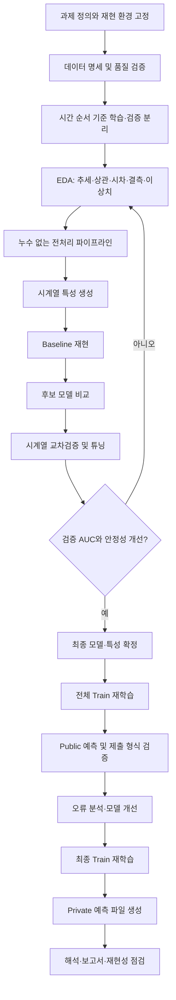

# 프로젝트 진행 흐름

## 목표와 평가 기준

- 목표: 일별 데이터를 사용해 D+3 시점의 KOSPI 지수(`Target_1`)와 건강식품 지수(`Target_2`) 상승 확률 예측
- 문제 유형: 두 개의 이진 분류 문제
- 핵심 지표: 각 타깃 ROC-AUC와 두 점수의 평균
- 평가 구성: Private AUC 평균 60점, 분석 설계·모델·결과 설명·재현성 40점
- 제약: 제공된 외부 데이터만 사용하며 Public/Private 평가 데이터에서 학습 정보를 얻지 않음

## 전체 흐름도

## 단계별 작업 순서

### 1. 프로젝트 기반 고정

- 초기 커밋에 원본 데이터, 변수 설명서, Baseline 노트북, 환경 파일을 포함한다.
- Python 및 주요 라이브러리 버전을 기록하고 모든 실험의 난수 시드를 고정한다.
- 원본 파일은 `data/raw/`에서 수정하지 않고 결과물은 `outputs/`에만 생성한다.

완료 조건: 새 환경에서 Baseline 노트북을 처음부터 끝까지 실행할 수 있다.

### 2. 데이터 검증

- Train 924일, Public 100일, Private 200일과 컬럼 구성이 명세와 일치하는지 검사한다.
- `Time_step` 정렬, 중복, 결측치, 무한값, 타깃 분포를 확인한다.
- 제출 예시의 키와 예측 컬럼(`Time_step`, `pred_1`, `pred_2`)을 확인한다.

완료 조건: 자동 검증 코드가 데이터 이상 여부를 명확하게 출력한다.

### 3. 시계열 검증 전략 수립

- 무작위 분할을 사용하지 않고 시간 순서 기준 Holdout 또는 expanding-window 검증을 사용한다.
- Public/Private 데이터는 모델 선택, 결측치 대체값, 스케일링, 특성 선택에 사용하지 않는다.
- 모든 전처리기는 각 학습 구간에서만 `fit`하고 검증 구간에는 `transform`만 적용한다.

완료 조건: 두 타깃별 AUC와 평균 AUC를 같은 검증 구간에서 재현할 수 있다.

### 4. EDA와 특성 설계

- 금융·쇼핑·키워드·날씨 그룹별 추세, 분포, 상관관계와 시차 관계를 분석한다.
- 변화율, 차분, lag, rolling 통계, 변동성 등은 과거 정보만 사용해 생성한다.
- 상수·고결측·중복·고상관 특성을 점검하고 제거 근거를 기록한다.

완료 조건: 채택한 특성마다 계산 시점과 누수 여부가 설명되어 있다.

### 5. 모델 실험

- Baseline Random Forest 결과를 먼저 재현한다.
- Logistic Regression 같은 단순 모델과 Random Forest, Gradient Boosting 계열을 동일 분할에서 비교한다.
- `Target_1`, `Target_2`는 각각 학습하고 타깃별 최적 모델이 다를 가능성을 허용한다.
- 실험마다 특성 버전, 파라미터, 타깃별 AUC, 평균 AUC를 표로 기록한다.

완료 조건: 최종 모델 선택 근거가 단일 점수가 아니라 여러 시간 구간의 성능과 안정성으로 제시된다.

### 6. 제출 및 최종 산출물

- 예측값이 0 이상 1 이하인지, 행 수와 `Time_step` 순서가 예시 파일과 같은지 자동 검사한다.
- Public 결과는 일반화 확인에만 사용하고 반복적인 리더보드 과적합을 피한다.
- 최종 코드에서는 Public/Private 입력만 전환하면 같은 파이프라인으로 제출 파일을 만들 수 있게 한다.
- 보고서에는 문제 정의, 데이터 분할, 누수 방지, 특성, 모델 비교, AUC, 중요 변수, 한계를 포함한다.

완료 조건: 노트북 재실행만으로 Private 제출 파일과 핵심 평가 결과를 재생성할 수 있다.

## 권장 커밋 단위

1. `chore: initialize project structure`
2. `feat: add data validation and time split`
3. `feat: add leakage-safe preprocessing pipeline`
4. `feat: add time-series feature engineering`
5. `feat: reproduce baseline model`
6. `feat: compare and tune candidate models`
7. `feat: generate validated submissions`
8. `docs: add analysis report and reproducibility guide`
